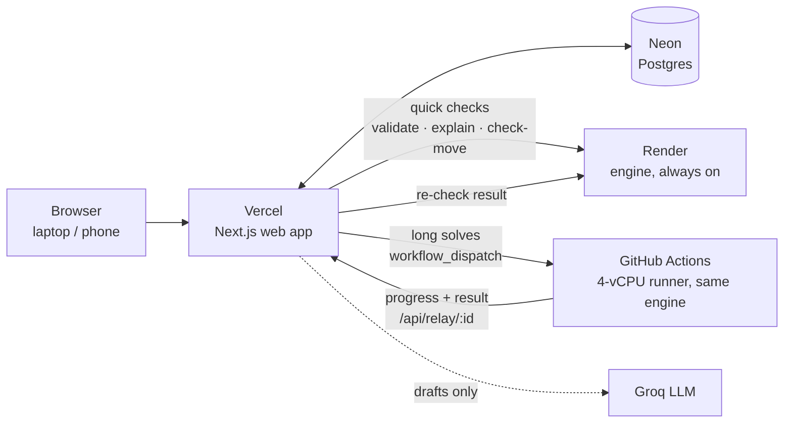

# CIT Scheduler

Campus scheduling and venue management for Chilika Institute of Technology (CIT Crunch Week).

- Generates a clash-free weekly timetable for all 189 sessions and schedules the 41 midsem exams.
- Turns plain English or Hinglish requests into editable bookings. The engine, not the AI, decides availability.
- Decides every Spectra-week booking by the priority rules, with a reason for each.
- Repairs the timetable after a change (faculty leave, room closure, new session) while moving as few sessions as possible. It shows exactly what changed and applies the fix only after an Admin approves.
- Runs as an operations console: live constraint monitor, a "right now" view, load analytics, a resilience scan and version history.
- Guides newcomers: an optional step-by-step tour that spotlights each part of the app, and **Iru**, a chat guide that answers "where do I…?" and takes you there.

Every result passes one deterministic checker that reproduces the official validator's results exactly. **AI reads and explains; code decides.**

## Live app

| | URL |
| --- | --- |
| **App (use this)** | https://cit-scheduler-three.vercel.app |
| Mirror | https://cit-scheduler.onrender.com |
| Engine health | https://cit-engine.onrender.com/health |

### Demo accounts

All four share the password **`crunchweek`**. The homepage and the login page both have one-click buttons for each.

| Role | Email | Can |
| --- | --- | --- |
| Admin (Dean's office) | `admin@cit.demo` | Everything: generate, approve, disruptions, reset, export |
| Department coordinator (CSE) | `coord.cse@cit.demo` | CSE changes, approve CSE lab bookings, resilience, versions |
| Faculty (F07, Dr. Pooja Das) | `faculty.f07@cit.demo` | Own timetable, change requests via the AI assistant |
| Club representative (Coding Club) | `club.coding@cit.demo` | Venue requests, status and reasons |

**Reset:** Admin → **Data** → **Reset demo data** restores the public dataset with no timetable. Then open **Generate**.

## Results on the public dataset

Both files in `exports/` were produced through the app's engine API (`scripts/generate_exports.py`) and scored with the unmodified `starter/validator.py`:

| File | Hard | Soft | Booking score | Priority inversions | Exam penalty | Moved |
| --- | --- | --- | --- | --- | --- | --- |
| `exports/schedule.json` | **0** | **3** | **67 / 70** | 0 | 0 | – |
| `exports/schedule_after.json` (sample disruption) | **0** | 3 | 67 | 0 | 0 | 13 (2 time, 11 room-only) |

67/70 is the most any schedule can score here. BR-09 asks for 1,200 seats and the largest venue holds 800. BR-17 runs past 22:00, so it can only get an alternative.

## Hosting: what runs where, and why

Constraint: **only free tiers, no credit card**. Each part sits on the free platform that suits its workload best.



| Part | Platform | Why this one |
| --- | --- | --- |
| Web app | **Vercel** (Hobby) | Native Next.js host, global CDN, and it **never sleeps**, so a judge's first visit is instant. Deploys from GitHub. |
| Database | **Neon** (free) | Serverless Postgres that does **not expire**; Render's free Postgres is deleted after 30 days. Works from both Vercel and Render. |
| Engine, quick calls | **Render** (free, Docker) | Always-on HTTPS endpoint for the light, millisecond-scale calls: validation, move checks, explanations, booking checks, export. |
| Engine, long solves | **GitHub Actions** (public repo: free 4 vCPU / 16 GB runners) | Generate, disruption repair, change evaluation and the resilience scan need real CPU. Render's free instance has about 0.1 CPU: we measured Generate failing to find any timetable within 120 s there. A runner solves the same job with the same code in about 1–2 minutes plus about a minute of start-up. |
| LLM | **Groq** (`gpt-oss-20b` / `gpt-oss-120b`) | Free tier with fast inference for drafts and explanations. With no key, a deterministic parser takes over. |

**What we tried and ruled out:**

| Option | Why not |
| --- | --- |
| Hugging Face Spaces | Docker and Gradio Spaces on free CPU now require a paid PRO plan. |
| Modal | Needs a credit card. |
| Render free for everything | 0.1 CPU: Generate timed out with no solution. The free database expires in 30 days. |
| Solving in the browser | OR-Tools CP-SAT has no supported WebAssembly build. It would mean rewriting four solvers, and the results would depend on the judge's device. |

**How the solver relay works** (`web/src/server/relay.ts`, `.github/workflows/engine-relay.yml`, `engine/relay_worker.py`):

1. The web app stores the request (dataset, schedule, options) under `relay:<id>` in Postgres and dispatches the `Engine relay` workflow with only that id.
2. The runner checks out the repo, installs the engine from `uv.lock` (cached) and starts it locally.
3. It fetches the request from `/api/relay/<id>` and streams progress and the final result back to the same URL. Both directions are authenticated with the engine shared secret. The callback base URL is a repository variable, so a dispatch cannot redirect it.
4. The web app polls the stored state exactly like a normal engine job. Before storing any relayed timetable, it **re-validates it on the always-on engine**.
5. If GitHub can't be reached, the job falls back to the always-on engine. A runner that never starts or goes silent is reported as failed after a few minutes. The workflow only reads the repository; it never commits.

## Features by role

| | Admin | Dept coordinator | Faculty | Club rep |
| --- | :-: | :-: | :-: | :-: |
| Dashboard: greeting with quality grade and midsem countdown, KPIs with trend, "week in numbers" (8 stats), engine status, constraint monitor, "right now" slot explorer, peak hours, faculty load, student day-load, Spectra split, room heatmap | ✓ | ✓ | ✓ | ✓ |
| Guided tour (optional, step by step, highlights each part with "what it is / your task") and Iru, the chat guide | ✓ | ✓ | ✓ | ✓ |
| Timetables by group / faculty / room, "Why here?" explanations, ⌘K jump, **Add to calendar (.ics)** | ✓ | ✓ | ✓ | ✓ |
| Midsem exams view (exam week grid, group filter, half-capacity seats) | ✓ | ✓ | ✓ | ✓ |
| Find a room; book a venue (AI or manual form, live conflict check); my requests | ✓ | ✓ | ✓ | ✓ |
| Spectra week board (every decision and reason) | ✓ | ✓ | ✓ | ✓ |
| **Priority order** editor (problem statement §4; exams and classes stay first) | edit | view | view | view |
| Change request in plain language (AI) or by form | ✓ | own dept | own sessions | |
| Move a session with live hard-rule checking | applies | proposes | proposes | |
| Approvals inbox | everything | own dept's labs | | |
| **Resilience scan:** simulate losing the busiest teachers and rooms for a day; each case repaired by the real engine | ✓ | ✓ | | |
| **Versions:** timetable history, soft-penalty trend, diff vs current, restore | restore | view | | |
| Generate timetable + exams + Spectra decisions (up to 8 min on the runner) | ✓ | | | |
| Disruptions: change file → minimal fix → diff → approve | ✓ | | | |
| Data: reset demo data, upload dataset, export `schedule.json` | ✓ | | | |

Nobody can approve their own request. This is enforced in code and by a DB check constraint. Engine-generated disruption fixes are authored by a "Scheduling engine" system user, so the uploading Admin can approve them.

## Architecture

Full write-up with flow diagrams: [docs/ARCHITECTURE.md](docs/ARCHITECTURE.md).

```
 Browser ─► Next.js 16 (web/)                                    Python engine (engine/)
            • Better Auth (4 roles)                              FastAPI, stateless
            • Drizzle ─► Postgres (Neon)            HTTPS +      • checker.py    validator-equivalent rules
            • workflows: bookings, approvals,  ───────────────►  • timetable.py  CP-SAT (feasibility → optimise)
              proposals, disruptions, versions      secret       • exams.py      CP-SAT
            • relay.ts: long jobs → GitHub Actions               • bookings.py   CP-SAT allocator, reasons, overrides
            • insights.ts: dashboard analytics                   • repair.py     minimal-change re-solve + diagnosis
            • AI layer (server only) ─► Groq / Anthropic         • resilience.py scenario scan using repair
                draft JSON → Zod → normaliser → engine           • explain.py    slot-by-slot "why" traces
                (deterministic parser if AI is down)             • changes.py    AI/manual ops → validated proposal
```

- **Validity gate.** `checker.py` implements H1–H14, B1–B3, E1–E2, S1–S6, the booking score, priority inversions and stability. `engine/tests/test_oracle.py` runs the official validator on 150+ random schedules and asserts identical reports. Every write path re-checks with the engine: generation, booking submit and approval, manual moves, proposals, approval, relayed results and export.
- **Timetable.** One start literal per session (or per elective basket). Rooms use optional intervals with a `NoOverlap` per room. Domains are pruned for lunch, lab starts, fixed slots, availability, capacity and type. The optimise phase uses the scorer's weights and also reserves room and group space for Spectra requests.
- **Spectra bookings.** CP-SAT objective `1000·weight·(2 approved | 1 alternative) + rank`, so priority inversions can't happen at the optimum. If an institute event is blocked only by classes, those classes move for Week 7 (room swap first) via `session_overrides`, and the week is re-checked.
- **Repair.** One model hinted at the current timetable, objective `1000·moved + 5·time-changed + soft`. If no fix exists, the engine re-solves allowing sessions to stay unplaced and reports exactly which sessions can't fit and what blocks them.
- **Resilience.** For the most loaded teachers and rooms, `resilience.py` builds a one-day loss on their busiest day and runs the same repair on each. It reports fixable, no fix (proven) or timed out, plus moves needed. Nothing is applied.
- **Explanations.** For "why is X here?", the engine holds everything else fixed, tests every start time, and reports the first rule that blocks each one plus the best alternatives with their soft-penalty change.

## AI layer

| Feature | Model (Groq default) | Guard rails |
| --- | --- | --- |
| Booking request → editable form | `openai/gpt-oss-20b`, strict JSON schema | Zod-validated, then normalised by code. Explicit clock times are re-mapped by code. Named rooms are checked (SH-2 not accessible → SH-1 suggested; "LHC-5" → "did you mean LH-5?"). Category capped by role. The engine decides availability. |
| Faculty change assistant | `openai/gpt-oss-120b`, tool calling | Read-only tools plus `propose_change`. Operations are scope-checked (own sessions only) and evaluated by the engine. An Admin approves. |
| "Why here?" wording | `openai/gpt-oss-20b` | Only rewords engine facts; the facts stay visible |
| **Iru**, the navigator | `openai/gpt-oss-20b` (`NAVIGATOR_MODEL`) | Two tools only: open a page from the user's allowed site map (re-checked in code) or start the tour. Per-user rate limit. An offline keyword guide answers with no key, when rate-limited, or on errors. |

If AI is down (no key, timeout, rate limit), the deterministic English and Hinglish parser fills the form and a banner says so. The homepage runs that same parser in the browser as a live demo. Full declaration: [AI_USAGE.md](AI_USAGE.md).

## Tech stack

| Layer | Choice |
| --- | --- |
| Web | Next.js 16 (App Router), React 19, TypeScript, Tailwind CSS 4, Base UI, cmdk, Sonner |
| Look | Syne / Instrument Serif / Manrope / JetBrains Mono (landing), Geist (panel); three.js landing scene; Lenis smooth scroll |
| Auth / DB | Better Auth (email + password, role column), Drizzle ORM, PostgreSQL (Neon) |
| Engine | Python 3.13, FastAPI, OR-Tools CP-SAT, uv, Docker |
| Compute | Render (always-on engine), GitHub Actions (long solves) |
| AI | Groq (gpt-oss-20b / gpt-oss-120b) or Anthropic |
| Tooling | pnpm, Biome, Vitest, pytest |

## Local setup

Prerequisites: Python 3.13 with [uv](https://docs.astral.sh/uv/), Node 22+ with pnpm, and PostgreSQL 16 (local or `docker compose up db`).

Copy the environment file, then set `BETTER_AUTH_SECRET` (for example with `openssl rand -hex 32`) and optionally `GROQ_API_KEY`:

```bash
cp .env.example web/.env
```

Engine:

```bash
cd engine && uv sync && uv run uvicorn app.main:app --port 8000
```

Web (in a second terminal):

```bash
cd web && pnpm install && pnpm db:push && pnpm seed && pnpm dev
```

Open http://localhost:3000, sign in as Admin, open **Generate** and run it (about 1–2 minutes on 4 cores). Locally every job runs on your own engine; the relay is only used when `GITHUB_RELAY_TOKEN` and `GITHUB_RELAY_REPO` are set.

Regenerate the exports while the engine is running, then check them with the official validator, from the repo root:

```bash
python scripts/generate_exports.py
```

```bash
python starter/validator.py --data starter/data/cit_public.json --schedule exports/schedule.json
```

```bash
python starter/validator.py --data starter/data/cit_public.json --schedule exports/schedule_after.json --disruption starter/examples/sample_disruption.json --baseline exports/schedule.json
```

Tests:

```bash
cd engine && uv run pytest
```

```bash
cd web && pnpm typecheck && pnpm lint && pnpm test
```

## Deploy (free, no card)

1. **Neon:** create a project and copy the **pooled** connection string (`…-pooler…?sslmode=require`).
2. **Render (engine):** New → Web Service from this repo, runtime Docker, Dockerfile `engine/Dockerfile`, context `.`, health check `/health`. Set `ENGINE_SHARED_SECRET` (random), `ENGINE_SOLVER_WORKERS=1`.
3. **GitHub (relay):** in the repo settings add the Actions **secret** `ENGINE_SHARED_SECRET` (same value) and the **variable** `RELAY_BASE_URL` (the web app URL). Create a fine-grained token with *Actions: read and write* on this repo only.
4. **Vercel (web):** import the repo with Root Directory `web`. Install command `npx -y pnpm@12.16.1 install --frozen-lockfile`, build command `npx -y pnpm@12.16.1 build`. Set the variables from `.env.example`: `DATABASE_URL`, `BETTER_AUTH_SECRET`, `BETTER_AUTH_URL`, `ENGINE_URL`, `ENGINE_SHARED_SECRET`, `GITHUB_RELAY_TOKEN`, `GITHUB_RELAY_REPO`, `AI_PROVIDER`, `GROQ_API_KEY`, `DEMO_TODAY`, `DEMO_PASSWORD`.
5. **First boot:** create the tables and seed the demo data once. Either run `pnpm db:push && pnpm seed` with the Neon URL, or deploy any Node host with `pnpm boot`. `pnpm boot` pushes the schema and seeds only when the database is empty, so restarts never wipe data.

Optional: `render.com` can also host the web app as a mirror with start command `pnpm boot`. `engine/modal_app.py` deploys the engine to Modal if you have a Modal account.

## Judge walkthrough (about 5 minutes)

0. **New here?** After signing in, accept the optional **tour**, or press the compass button any time. It walks through every page with "what it is" and "your task". Or ask **Iru** (bottom-right), e.g. "where do I book the auditorium?".
1. **Homepage → Admin.** One click signs you in.
2. **Generate → Generate timetable.** It runs on a 4-CPU GitHub Actions runner; allow about a minute for start-up. Then open **Dashboard**: 0 hard violations, constraint monitor all green, peak hours, loads.
3. **Timetables.** Switch Group, Faculty or Room, or press ⌘K / Ctrl+K and type a name. Click a class, then **Why here?**.
4. **Dashboard → Right now.** Scrub any day and period to see running classes and free rooms. **Find a room** books one.
5. **Club rep → Book a venue.** Click "seminar hall kal shaam 6 baje…": the form fills, assumptions are shown, and the engine shows availability. Submit it. Try the 1,200-person or "institute event, approve it now" examples to see a conflict blocked and a priority claim capped.
6. **Admin → Approvals.** Approve the club's booking. **Spectra week** shows every dataset decision with its reason.
7. **Admin → Disruptions → Use sample disruption → Propose a fix.** You land on the diff (summary, from → to per session, before/after grid, validation), then **Approve**. **Versions** now shows both timetables.
8. **Faculty → Change request.** Type "I can't take Thursday mornings, move my CS203 lecture to Friday afternoon". The engine-checked fix appears; **Submit for Admin approval**.
9. **Admin → Resilience → Quick scan.** See how many one-day losses of the busiest teachers and rooms the timetable can absorb, and at what cost.

## Repository layout

```
engine/          FastAPI + OR-Tools: app/{dataset,checker,timetable,exams,bookings,repair,resilience,explain,changes,export,jobs,main}.py,
                 relay_worker.py (GitHub Actions side of the relay), modal_app.py (optional host), tests/
web/             Next.js: src/app (pages + API routes), src/components (shell, dashboard, guide, landing, timetable, workflow),
                 src/server (env, db, auth, engine client, relay, ai, workflows), src/lib (sitemap, tour, schemas, parser, insights, ics)
docs/            ARCHITECTURE.md (layers, flows, endpoints, security, tests)
.github/         workflows/engine-relay.yml (solver relay)
starter/         organiser starter pack, unmodified
exports/         schedule.json, schedule_after.json (generated by scripts/generate_exports.py)
scripts/         generate_exports.py
```

## Team and credits

- **Sai Ram Dash**: author of the project's logic and design. They worked out how the scheduler should behave (the rules, the workflows, the priority and approval logic, the features and the experience) and instructed Claude Code to implement it, then reviewed and tested the result against the problem statement.
- **Claude Code (Anthropic)**: implementation of that logic in code, working from Sai Ram Dash's instructions inside the Claude Code environment.

Full AI declaration (models the product calls, AI tools used to build it, and what the AI may not decide): [AI_USAGE.md](AI_USAGE.md). Third-party libraries and services: [THIRD_PARTY.md](THIRD_PARTY.md).

## Known limitations

- **Relay start-up:** a GitHub Actions runner takes about 30–60 s to start, so long jobs feel slower to begin than on a dedicated server. If GitHub is unreachable, jobs fall back to the always-on engine, which is slow on the free tier.
- **Free-tier sleep:** the Render engine sleeps after 15 idle minutes. The dashboard's engine pill shows this and has a **Wake** button (about 30–60 s).
- **Calendar scope:** bookings made in the app are for Week 7 (Spectra week). "Today" is pinned by `DEMO_TODAY`, so words like *kal* resolve predictably.
- **Exams:** scheduled once at generation. Change files affect the teaching timetable (and Spectra bookings), not the exam schedule.
- **Drag-and-drop:** manual moves use a slot picker with instant validation; there is no drag-and-drop on the grid.
- **Free AI tiers:** the free Groq tier rate-limits bursts. The deterministic fallback takes over automatically, with a banner.
