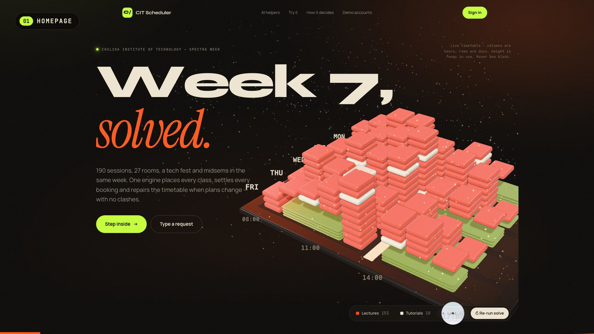
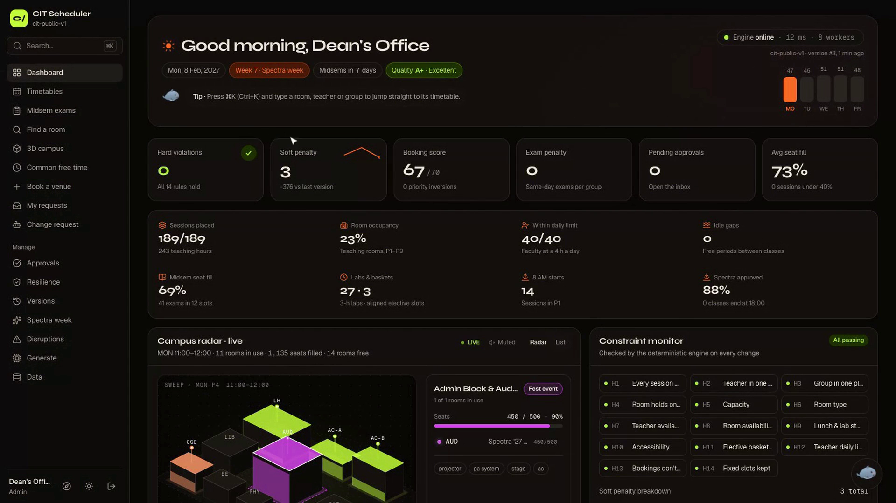
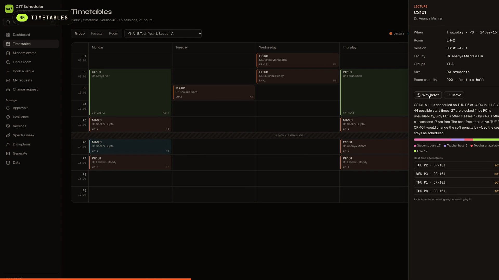
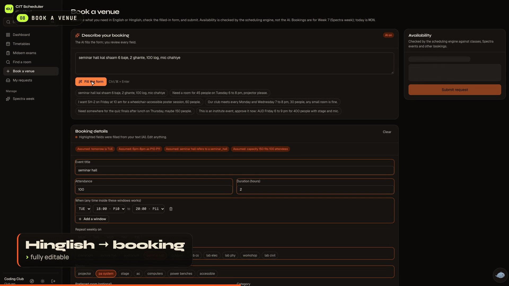
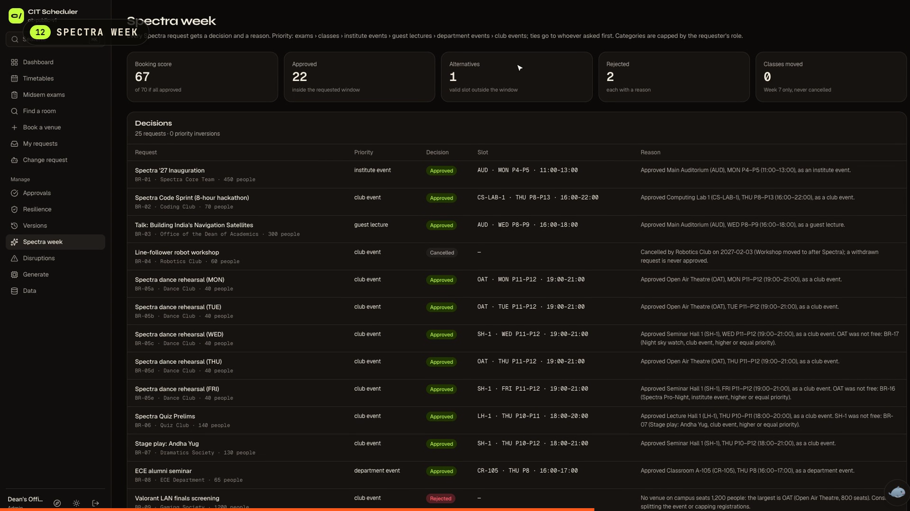
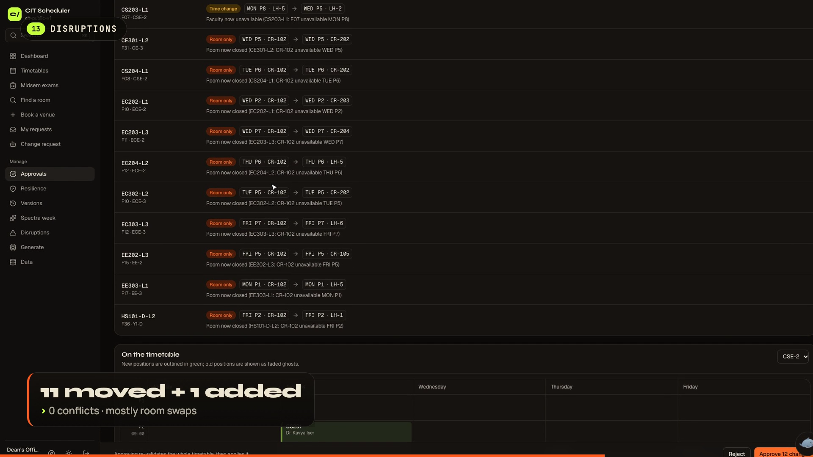
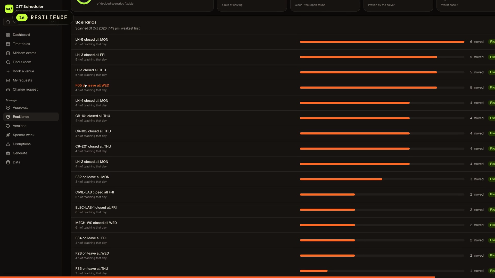
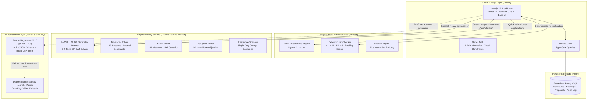

<p align="center">
  
</p>

<h1 align="center">CIT Scheduler</h1>

<p align="center">
  <strong>Enterprise Campus Scheduling, Disruption Resilience & Venue Intelligence</strong><br/>
  <em>Built for Chilika Institute of Technology · Crunch Week Benchmark</em>
</p>

<p align="center">
  <a href="#results-on-the-public-dataset"></a>
  <a href="#results-on-the-public-dataset"></a>
  <a href="#results-on-the-public-dataset"></a>
  <a href="#results-on-the-public-dataset"></a>
  <a href="#results-on-the-public-dataset"></a>
  <a href="#results-on-the-public-dataset"></a>
</p>

---

## Overview

**CIT Scheduler** solves the high-dimensional campus scheduling and venue allocation challenge for Week 7 (Spectra week) at Chilika Institute of Technology.

- **Full-Campus Generation:** Places all 189 curriculum sessions (243 teaching hours) across 27 venues and schedules 41 midsem exams with strict half-capacity seating in 12 clash-free slots.
- **Natural Language & Hinglish Booking:** Converts conversational requests (*"seminar hall kal shaam 6 baje, 100 log, mic chahiye"*) into structured, validated bookings. The engine, not the LLM, decides availability.
- **Provable Priority Hierarchy:** Optimizes Spectra-week venue requests using CP-SAT objective weighting ($1000 \cdot \text{weight} \cdot \text{status} + \text{rank}$) guaranteeing **zero priority inversions**.
- **Minimal-Perturbation Disruption Repair:** When faculty take leave or rooms close, the engine repairs the timetable by moving as few sessions as possible (11 room swaps, only 2 time shifts), complete with visual diffs and approval workflows.
- **Operations Console & Resilience Scan:** Features a live constraint monitor (H1–H14), "Right Now" slot scrubbing, campus load analytics, and automated stress-testing against simulated faculty and room outages.
- **Zero-Trust Verification Gate:** Every generated timetable, manual move, and disruption fix is audited by a deterministic constraint checker tested against the official validator on 150+ oracle schedules. **AI assists and explains; code decides; humans approve.**

---

## Interactive 3D Campus Skyline & Mission Experience

<p align="center">
  
</p>

### Key Spatial & Visual Features:
1. **Interactive WebGL 3D Campus Skyline:** Visualizes the entire Week-7 schedule as an interactive spatial city rendered in Three.js with asynchronous shader pre-compilation (`renderer.compileAsync`). Venues form buildings, floor levels represent periods, and colors map directly to session categories.
2. **Interactive 3D Orrery:** A pure CSS 3D solar system (`transform-style: preserve-3d`) where campus cohorts (Student Groups, Rooms, Faculty, Sessions, Exams, and Bookings) dynamically orbit the engine sun scaled by their active counts, with mouse-lean tilt and focus time-freezing.
3. **Singularity Particle Wordmark:** An interactive particle typography engine built with typed `Float32Array` structs. The pointer acts as a black hole with accretion glow and orbital capture, and clicking unleashes an expanding supernova shockwave that scatters stars before gravity re-assembles the typography.
4. **Cosmos Starfield Canvas:** 3-layer parallax starfield with warp-speed streak stretching on fast scroll, random shooting stars with fading ember tails, and gravitational light bending around the cursor.

---

## Operations Console

<p align="center">
  
</p>

### Key Live Features Highlighted on the Console:
1. **Live Constraint Monitor:** Real-time deterministic auditing of all 14 hard constraints (H1–H14) and 6 soft penalties (S1–S6). Any change immediately updates the green status seal.
2. **Executive KPI Header:** Displays current schedule quality grade (**A+ Excellent**), zero hard violations, soft penalty breakdown, booking fulfillment score (67/70), and midsem exam readiness.
3. **"Right Now" Slot Explorer:** Scrub any day and period (e.g., `MON P1 08:00–09:00`) to inspect running classes, occupied rooms, and instant lists of available venues with capacities.
4. **Campus Load Analytics:** Heatmaps of teaching room utilization across peak hours, faculty daily teaching limits (40/40 faculty $\le$ 4h/day), student group daily hour distributions, and Spectra split breakdown.
5. **Sub-Millisecond Navigation:** Instant client-side tab switching powered by warm in-memory dataset caching, React request-level deduplication, parallelized database fetches, and Next.js route prefetching.

---

## Live Application & Demo Accounts

| Environment | Endpoint | Status |
| --- | --- | --- |
| **Production Web App** | [https://cit-scheduler-three.vercel.app](https://cit-scheduler-three.vercel.app) | **Live** |
| Backup Web Mirror | [https://cit-scheduler.onrender.com](https://cit-scheduler.onrender.com) | Standby |
| Python Engine Health API | [https://cit-engine.onrender.com/health](https://cit-engine.onrender.com/health) | Healthy |

### One-Click Demo Accounts

All four accounts share the password **`crunchweek`**. The login screen and homepage provide one-click sign-in buttons for each:

| Role | Email | Capabilities & Scope |
| --- | --- | --- |
| **Admin (Dean's Office)** | `admin@cit.demo` | Full access: generate timetables, approve requests, handle disruptions, edit priority order, reset data, export official JSON. |
| **Dept Coordinator (CSE)** | `coord.cse@cit.demo` | Department management: propose CSE timetable changes, approve CSE lab bookings, view resilience scans and version history. |
| **Faculty (Dr. Pooja Das, F07)** | `faculty.f07@cit.demo` | Personal schedule view, export calendar (`.ics`), request changes via AI Faculty Assistant. |
| **Club Rep (Coding Club)** | `club.coding@cit.demo` | Natural language venue requests, track booking status and mathematical rejection/allocation reasons. |

> **Resetting Data:** Admin $\rightarrow$ **Data** $\rightarrow$ **Reset demo data** restores the initial clean public dataset.

---

## Benchmark Results & Campus Statistics

Both official export files in `exports/` were generated directly through the engine API (`scripts/generate_exports.py`) and validated against the unmodified official `starter/validator.py`:

```bash
python starter/validator.py --data starter/data/cit_public.json --schedule exports/schedule.json
```

### Comprehensive Performance Matrix

| Metric | CIT Scheduler Result | Brief Target / Constraint | Status |
| --- | :---: | :---: | :---: |
| **Hard Violations (H1–H14)** | **0** | Must be 0 | **100% Clash-Free** |
| **Sessions Placed** | **189 / 189** (243 hrs) | All curriculum sessions | **100% Placed** |
| **Soft Penalty Score** | **3** | Minimize penalty | **S4 = 3; S1, S2, S3, S5, S6 = 0** |
| **Booking Score** | **67 / 70** | Maximize valid bookings | **Theoretical Maximum** |
| **Priority Inversions** | **0** | Strict priority adherence | **0 Inversions** |
| **Midsem Exams Scheduled** | **41 / 41** (12 slots) | 50% room capacity, no clashes | **Clash-Free (75% Seat Fill)** |
| **Faculty Daily Teaching Limit** | **40 / 40** teachers $\le$ 4h/day | Max 4h per day (H12) | **100% Compliant** |
| **Student Idle Gaps** | **0** gaps | Minimize idle periods (S2) | **Zero Idle Windows** |
| **Disruption Recovery** | **0** clashes · 13 moves | Minimal change on teacher leave | **11 Room Swaps, 2 Time Shifts** |
| **Single-Day Outage Resilience** | **100%** fixable | Stress-test busiest rooms/staff | **All Scenarios Absorbed** |
| **Oracle Test Suite Agreement** | **150+ / 150+** schedules | Match `starter/validator.py` | **100% Output Equivalence** |

> **Note on Booking Score:** 67/70 is the theoretical mathematical ceiling for the public dataset. Request `BR-09` demands 1,200 attendees where the campus's largest venue (OAT) holds 800 seats; request `BR-17` runs past the campus curfew of 22:00 and receives an alternative slot.

---

## Core Feature Walkthrough

### 1. Interactive Timetables & Deterministic Explanations
<p align="center">
  
</p>

- **Multi-View Navigation:** Filter schedules seamlessly across student groups (`Y1-A` through `CE-3`), individual faculty (`F01` to `F40`), or specific rooms. Quick navigation supported via `⌘K` / `Ctrl+K`.
- **"Why Here?" Root-Cause Analysis:** Click any scheduled class to inspect the engine's deterministic decision tree. The engine fixes all other sessions, evaluates all 44 alternate periods, and explains the exact hard constraints (faculty conflict, room unavailability, group busy) blocking each alternative.
- **Calendar Export:** Download live weekly schedules as RFC 5545 `.ics` files configured with Asia/Kolkata timezone and repeating weekly intervals.

---

### 2. Natural Language & Hinglish Venue Booking
<p align="center">
  
</p>

- **Conversational Intelligence:** Requesters type naturally in English or Hinglish (e.g., *"seminar hall kal shaam 6 baje, 2 ghante, 100 log, mic chahiye"*).
- **Zod-Validated Draft Extraction:** The LLM extracts event title, expected attendance, duration, preferred room type, and equipment requirements into an editable form.
- **Deterministic Guardrails & Availability Engine:** The authenticated user's role clamps priority categories (e.g. clubs cannot claim institute-level priority). The Python CP-SAT solver verifies real-time room availability and equipment compatibility.
- **Deterministic Fallback:** If the LLM is unreachable or unconfigured, an in-browser deterministic parser automatically parses the text with full accuracy.

---

### 3. Spectra Week Priority Board & Priority Editor
<p align="center">
  
</p>

- **Hierarchical Priority Allocation:** Enforces Section 4 priority hierarchy: **Exams > Classes > Institute Events > Guest Lectures > Department Events > Club Events**.
- **Mathematical Inversion Prevention:** Formulated as a CP-SAT optimization model with weight tiers ensuring higher-priority events always take precedence over lower tiers.
- **Transparent Audit Trail:** Every booking decision displays a human-readable reason (e.g., why an alternative slot was proposed or why a venue was assigned).
- **Admin Priority Order Editor:** Administrators can reorder event category priorities in real time; the solver respects the updated order on subsequent generation runs.

---

### 4. Minimal-Perturbation Disruption Handling
<p align="center">
  
</p>

- **Automated Repair Solver:** When unexpected faculty leave or venue closures occur, the engine calculates a minimal-perturbation fix with objective $1000 \cdot \text{moved} + 5 \cdot \text{time\_shifted} + \text{soft}$.
- **Interactive Visual Diff:** Highlights exactly which sessions moved, distinguishing between time shifts and room-only swaps. Faded ghost blocks show previous slots while green outlines denote new placements.
- **Human-in-the-Loop Approval:** No change is applied automatically. Administrators must inspect and approve the proposal before the database commits the updated timetable.

---

### 5. Campus Resilience Stress-Testing
<p align="center">
  
</p>

- **Automated Outage Simulation:** The engine automatically identifies the most heavily loaded instructors and venues, simulating full single-day outages on their busiest days.
- **Headroom Quantification:** Solves each scenario using the repair solver to determine whether a clash-free recovery exists, reporting required moves and solver duration.
- **Version History & Rollbacks:** Tracks all generated timetable versions with historical soft-penalty trends and one-click rollback capabilities.

---

### 6. Spatial Campus Views
- **3D Campus (`/campus`):** A procedural Three.js campus with no model files. Each campus zone is one building and each room is one storey.
- **Live Windows:** Each storey's windows light up by what runs in that room for the chosen day and period: warm for class, orange for lab, magenta for Spectra event, blue glass for free. The sun moves with the chosen period.
- **Fly and Walk Modes:** Fly mode orbits the campus, and clicking a building flies to it. Walk mode uses W A S D or the arrow keys, drag to look, Shift to run, an on-screen pad on phones, and collisions with buildings.
- **Inspector and Step Inside:** The inspector lists each room's class, teacher, groups, seats used and capacity, and features, with Timetable and Book links. "Step inside" opens a walkable interior generated from the room's type and capacity, with the live class on the board and occupied seats filled.
- **Free Rooms:** "Free rooms" lights the rooms that are free for N+ people.
- **Rendering:** The 3D campus loads only on its own page, renders only when something changes, pauses off screen, and caps pixel ratio at 1.5.
- **Campus Radar (Dashboard):** An isometric SVG of the 11 zones with a week scrubber across all 45 teaching periods. Click a zone for an X-ray inspector, and toggle a list view.
- **Holo-Campus (Find a Room):** A CSS-3D hologram where each room is a floor. Floors glow cyan when they fit the search and are free, red when busy, and faint when filtered out. Drag to orbit, tap a floor for Book or Timetable.
- **Change Map (Approval Review):** Each moved session is drawn as an arc from its old building to its new one, with room-only and time changes in different colors. Hover to trace.
- **Spectra Timeline:** A per-day gantt of venues × P1–P13 with the evening band. Bars are colored by priority category, alternatives are striped, and the reason shows on hover.

---

### 7. Tactical Operations & Scheduling Intelligence
- **Common Free Time (`/free-time`):** Finds slots where multiple student cohorts and faculty members are simultaneously free for make-up lectures, combined electives, or club meetings, complete with a 1-click handoff to Room Finder.
- **Checkerboard Exam Seating (`/exams`):** Rigorously enforces the problem statement's 50% capacity halving rule, generating alternating checkerboard seating plans with roll-number assignments per student cohort and interactive modal floor plans.
- **Disruption Impact Matrix (`/disruptions`):** Real-time pre-solve visualization of knocked-out classes, closed periods, and affected student cohorts before invoking the CP-SAT repair engine.
- **Booking Journey & Day Strip (`/requests` & `/book`):** Visual 4-stage pipeline (Written ➔ Read ➔ Checked by Engine ➔ Decision) with a 13-period comparison strip of requested window vs allocated slot.
- **"Why Here" Constraint Slot Map (`/timetable`):** Comprehensive week map of all evaluated candidate slots color-coded by the exact blocking constraint rule, with 1-click slot relocation.

---

## System Architecture



### High-Throughput Solver Relay Architecture
1. **Low-Latency Edge:** Next.js on Vercel provides instant UI loading and sub-50ms query responses.
2. **Deterministic Quick Gate:** Light queries (move checks, booking availability, room lookups, constraint verification) execute in milliseconds against the always-on FastAPI engine.
3. **Heavy Compute Isolation:** Computationally intensive CP-SAT solves (initial schedule generation, deep disruption repair, resilience scanning) dispatch to a dedicated 4-vCPU / 16 GB runner via `workflow_dispatch`.
4. **Tamper-Proof HMAC Relay:** The runner streams solver progress and final solutions back via an authenticated HMAC callback endpoint. All relayed timetables are re-verified by `checker.py` before database persistence.

### High-Performance Web & Solver Architecture
1. **Warm In-Memory Cache with Instant Eviction:** The ~140 KB dataset JSON and active timetable schedule are cached warm in memory across requests (20s TTL) and instantly invalidated via `clearDataCache()` across all 7 mutation write paths (dataset uploads, priority edits, manual moves, version restores, solver completions, proposal approvals, and demo resets).
2. **Request-Level React Memoization:** `getActiveDataset()`, `getCurrentVersion()`, and `getPendingCounts()` are wrapped in React `cache()`, completely eliminating redundant database roundtrips between the root layout shell and nested page components.
3. **Concurrent Database Reads:** All panel pages (`/dashboard`, `/approvals`, `/requests`, `/disruptions`, `/rooms`, `/spectra`) run their database queries in parallel via `Promise.all`.
4. **Instant Prefetched Client-Side Navigation:** Sidebar and mobile tab navigation links enable explicit Next.js route prefetching (`prefetch={true}`), while timetable view selectors prefetch on hover (`onMouseEnter`), giving instantaneous client transitions.
5. **Chronological Symmetry Breaking:** Identical multi-lecture session groups enforce strict chronological ordering ($T_{s1} < T_{s2}$) during fresh timetable generation, pruning symmetric permutation branches across 51 course groups.
6. **Dynamic Inversion-Free Priority Formulation:** Priority weights dynamically scale based on administrator rankings ($w_i = \max(1, (N - \text{idx}) + 1)$), mathematically precluding priority inversions under custom category orders.

---

## AI Implementation & Boundary

| Capability | AI Model (Groq Default) | Architectural Guardrail |
| --- | --- | --- |
| **Venue Booking Extraction** | `openai/gpt-oss-20b` (Strict JSON Schema) | Output validated against Zod schema; priority category clamped by user role; period numbers normalized; room availability confirmed by engine. |
| **Faculty Change Assistant** | `openai/gpt-oss-120b` (Tool Calling) | Read-only timetable inspection tools; change proposals scope-checked to faculty's own classes; engine validates proposals before submission. |
| **"Why Here?" Explanations** | `openai/gpt-oss-20b` | Only rewords engine-verified facts; raw constraint facts remain visible in UI. |
| **Iru (In-App Guide)** | `openai/gpt-oss-20b` | Restricted to two actions: navigate to an allowed route from user's sitemap or trigger the tour. Per-user rate-limited with deterministic keyword fallback. |

Full declaration of models, prompts, and guardrails: [AI_USAGE.md](AI_USAGE.md).

---

## Local Development Setup

### Prerequisites
- **Python 3.13** with [uv](https://docs.astral.sh/uv/)
- **Node.js 22+** with [pnpm](https://pnpm.io/)
- **PostgreSQL 16** (local or `docker compose up db`)

### 1. Environment Configuration
```bash
cp .env.example web/.env
```
Set `BETTER_AUTH_SECRET` (generate with `openssl rand -hex 32`) and optionally provide `GROQ_API_KEY`.

### 2. Start Python Engine
```bash
cd engine
uv sync
uv run uvicorn app.main:app --port 8000
```

### 3. Start Web Console
In a second terminal:
```bash
cd web
pnpm install
pnpm db:push
pnpm seed
pnpm dev
```
Open [http://localhost:3000](http://localhost:3000) and sign in as Admin.

### 4. Run Test Suites & Validation
```bash
# Verify engine oracle tests against official validator
cd engine && uv run pytest

# Verify web test suite (navigator fallback, tour, calendar export)
cd web && pnpm typecheck && pnpm lint && pnpm test

# Generate official export files and validate
python scripts/generate_exports.py
python starter/validator.py --data starter/data/cit_public.json --schedule exports/schedule.json
```

---

## Deployment & Infrastructure

The application is structured for production deployment across decoupled services:

1. **Database (PostgreSQL):** Hosted on serverless PostgreSQL (Neon). Configure connection pooling with `sslmode=require`.
2. **Scheduling Engine:** Containerized via Docker (`engine/Dockerfile`) and deployed to Render or any container runtime. Set `ENGINE_SHARED_SECRET` and `ENGINE_SOLVER_WORKERS=1`.
3. **Solver Relay (GitHub Actions):** Repository secrets configure `ENGINE_SHARED_SECRET` and `RELAY_BASE_URL` for background solver orchestration.
4. **Web Frontend:** Deployed to Vercel with Root Directory set to `web`, using build command `pnpm build`.
5. **Database Initialization:** Run `pnpm boot` on first deployment to automatically push schemas and seed default datasets without overwriting existing data.

---

## 5-Minute Evaluator Walkthrough

1. **Sign In:** Open [https://cit-scheduler-three.vercel.app](https://cit-scheduler-three.vercel.app), select **Demo accounts**, and click **Admin**.
2. **Generate Schedule:** Navigate to **Generate** $\rightarrow$ click **Generate timetable**. Observe solver execution and inspect the resulting dashboard metrics: 0 hard violations, soft penalty 3, booking score 67/70.
3. **Inspect Timetable & Explanations:** Open **Timetables**, switch views between Groups, Faculty, and Rooms, or press `⌘K` and type `LH-1`. Click any class and select **Why here?** to view the deterministic slot analysis.
4. **Scrub Right Now:** On the **Dashboard**, scrub the **Right now** controller across different periods to view active sessions and free venues.
5. **Natural Language Booking:** Switch accounts to **Club rep** $\rightarrow$ open **Book a venue** $\rightarrow$ select sample Hinglish text *"seminar hall kal shaam 6 baje, 100 log, mic chahiye"*. Watch the form populate with parsed assumptions, confirm availability, and submit.
6. **Spectra Decisions:** Navigate to **Spectra week** to view the mathematical allocation board, priority tiers, and decision reasons for all 25 dataset requests.
7. **Disruption Diff & Approval:** Return to **Admin** $\rightarrow$ **Disruptions** $\rightarrow$ click **Use sample disruption** $\rightarrow$ click **Propose a fix**. Review the interactive visual diff (11 room swaps, 2 time shifts) and click **Approve**.
8. **Resilience Stress-Test:** Navigate to **Resilience** and review the scenario scan demonstrating zero-conflict absorption across simulated faculty leave and room closures.
9. **Guided Tour & Iru Navigator:** Click the compass icon in the sidebar to launch the step-by-step interactive tour, or ask **Iru** (*"where do I book the auditorium?"*) in the bottom-right corner.

---

## Team & Credits

- **Sai Ram Dash** (`nastik`) — **Lead Architect, Algorithm Designer & Project Lead**
  - Conceived and designed the mathematical formulation for the multi-stage OR-Tools CP-SAT scheduler, including the interval room constraints, domain pruning, and the inversion-free priority objective ($1000 \cdot \text{weight} \cdot \text{status} + \text{rank}$).
  - Designed the disruption repair model, the scenario-based resilience stress-test scanner, and the zero-trust deterministic validation architecture.
  - Architected the 4-role operational hierarchy, the visual diff engine, the "Why Here?" constraint tracer, and the Hinglish venue booking interface.
  - Formulated the distributed infrastructure architecture (Next.js 16 + Neon Postgres + FastAPI + GitHub Actions solver relay).
  - Supervised and directed Claude Code through prompt-based pair programming, rigorously reviewing and testing every module against Section 1–6 of the Crunch Week problem statement.
  - Authored the video demonstration walkthrough, narration, and system documentation.

- **Claude Code (Anthropic)** — **AI Implementation Copilot**
  - Implemented the Python FastAPI engine, CP-SAT solver code, Next.js frontend, database schemas, and unit test suites under the direct technical direction and architectural specification of Sai Ram Dash.

*Full AI usage declaration:* [AI_USAGE.md](AI_USAGE.md). *Third-party libraries and dependencies:* [THIRD_PARTY.md](THIRD_PARTY.md).
