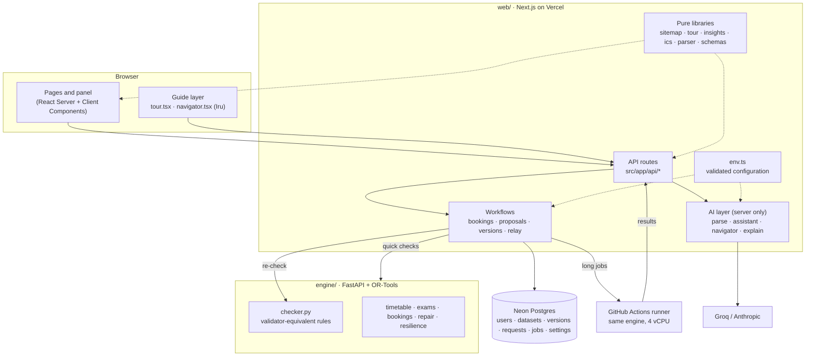
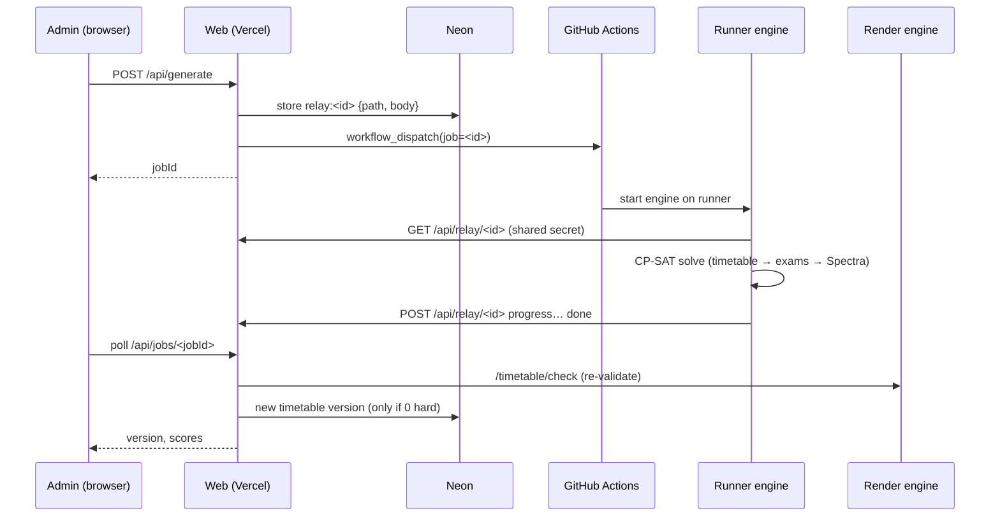

# Architecture

CIT Scheduler is split by responsibility: **the engine decides, the web app orchestrates, the AI only reads and explains.** This page describes the layers, the main request flows, and the rules each layer follows.

## 1. Layers

| Layer | Lives in | Rules |
| --- | --- | --- |
| **Engine** | `engine/app` | Stateless. Every request carries the dataset (and change file and schedule). The only place that decides validity (`checker.py`, oracle-tested against the official validator). |
| **Workflows** | `web/src/server` | Persistence, roles, approvals and job tracking. Every write path re-checks with the engine. Nobody approves their own request (code and DB constraint). |
| **AI layer** | `web/src/server/ai` | Server only. Produces drafts, proposals-to-validate and wording. Each feature has a deterministic fallback. It never writes to the DB directly. |
| **Pure libraries** | `web/src/lib` | No I/O; unit-tested. Shared by server and client. |
| **Configuration** | `web/src/server/env.ts` | Zod-validated, parsed lazily (builds don't need secrets). Optional features switch off when their variables are empty. |

## 2. Single sources of truth

- **Site map** (`src/lib/sitemap.ts`): every page's path, roles, icon, shortcut, *what it is*, *what to do there* and search keywords. The sidebar, ⌘K palette, mobile tabs, guided tour and AI navigator all read it, so a new page shows up everywhere at once. The navigator cannot send anyone to a page that is not in their role's slice of it.
- **Rules**: the hard and soft rules live once, in `engine/app/checker.py`. The web app only labels them (`HARD_RULES` in `src/lib/insights.ts`).
- **Data formats**: `src/lib/schemas` (Zod) mirror the starter-pack formats; the engine's Pydantic models accept the same JSON.

## 3. Main flows

### Generate (long job through the relay)

If the dispatch fails, `startJob` sends the job to the always-on engine instead. Relay records time out after 6 minutes in the queue or 3 minutes of silence.

### Booking request (AI with a fallback, engine decides)

1. The user types English or Hinglish. `parse.ts` asks the LLM for a strict-schema draft. If there is no key or the call fails, `parser.ts` (deterministic) produces it instead.
2. `normalizeDraft` (code) re-reads clock times, resolves room names, caps the category by role and flags conflicts.
3. The user edits the form. `/bookings/check-one` on the engine decides availability.
4. Submit → pending → an approver (never the requester) decides. Approval re-checks the engine.

### Navigator (Iru)

1. `POST /api/navigator` with the message, the last 6 turns and the current path.
2. Per-user rate limit (`NAVIGATOR_RATE_PER_MIN`). Over the limit, or with no key or an error, it falls back to `fallbackNavigator` (keyword scoring over the site map; unit-tested).
3. The LLM has exactly two tools: `go_to_page(href ∈ role's pages)` and `start_tour()`. `toAction` re-checks the href against the role's pages.
4. The client performs the single returned action (`router.push` or start the tour). Iru never reads or changes scheduling data.

### Guided tour

`tourFor(role)` = dashboard steps + one step per page in the role's site map + Iru. Each step names a `data-tour` target. The overlay navigates, finds the element, spotlights it and shows *what it is* and *your task*. First-time users get an **optional** invitation card; the compass button and Iru start it any time.

## 4. Engine endpoints

| Endpoint | Kind | Used for |
| --- | --- | --- |
| `/pipeline/generate` | job | Timetable + exams + Spectra decisions |
| `/disruptions/repair` | job | Minimal-change fix for a change file |
| `/changes/evaluate` | job | AI or manual change ops → validated proposal |
| `/analysis/resilience` | job | One-day-loss scenarios, each repaired (analysis only) |
| `/timetable/check`, `/timetable/check-move`, `/bookings/check-one`, `/timetable/explain`, `/export` | sync | Validation, live move checks, availability, "why here?", export |
| `/jobs/{id}`, `/health` | sync | Job polling, liveness |

Jobs (`kind: job`) go through the relay when it is configured; sync calls always go to the always-on engine.

## 5. Security notes

- Engine and relay endpoints require `X-Engine-Secret`. The relay callback base URL is a repository *variable*, so a workflow dispatch cannot redirect the secret.
- Accounts are seeded; self sign-up is disabled, and the role field can't be set from input.
- LLM input is wrapped as data. The parse call has no tools, and the assistant and navigator tools are read-only or navigation-only.
- The runner workflow has `contents: read` and never pushes.

## 6. Testing

| Suite | Command | Covers |
| --- | --- | --- |
| Engine | `cd engine && uv run pytest` | Checker vs official validator (oracle), solvers, repair, resilience, API |
| Web | `cd web && pnpm test` | Hinglish parser, time maps, navigator fallback, tour steps, ICS export |
| Types and lint | `pnpm typecheck && pnpm lint` | Strict TypeScript (`noUncheckedIndexedAccess`), Biome |
